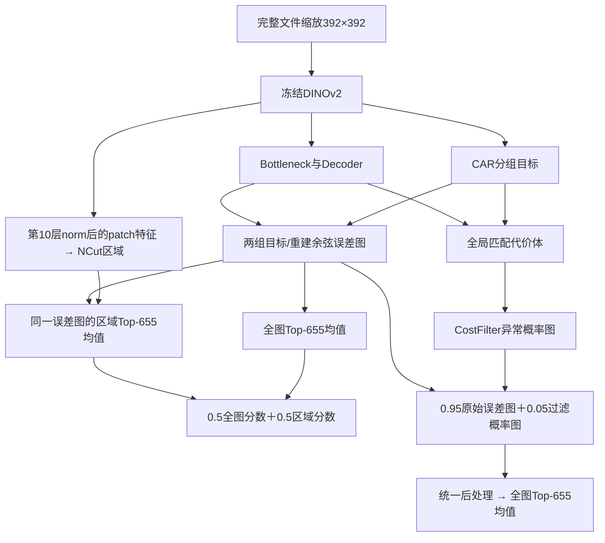

# 方法如何实现

## 共同基础

输入是InsPLAD已经存储的部件图片，全图双线性缩放到392×392；不中心裁剪、不补边。非方图会改变宽高比，“完整视野”指保留当前文件的全部内容，不代表还原数据制作者裁剪之前的无人机整帧。

DINOv2 ViT-B/14带4个register tokens，编码器冻结。Dinomaly2读取零基索引2到9的8层特征，经过Noisy Bottleneck和8层Decoder重建。`lc=2`将8层分为前4/后4两组，各组取平均。`cr=1`保留CAR：编码器分组patch特征减去本组CLS特征，再做LayerNorm，作为重建目标。Decoder输出去掉CLS和register tokens。每组目标/重建为`B×768×28×28`。

训练时保留原Loose全局余弦损失和梯度筛选；本次三个实验不使用PCA权重、人工掩码损失或前景加权。原实现见`vendor/dinomaly2/dinomaly_2D.py::build_model`、`models/uad.py::Dinomaly.forward`、`utils.py::global_cosine_hm_percent`。

## 实验1：A5000全图评分

两组对应位置的余弦距离取平均；28网格插值到392，再缩放256，经过5×5、sigma=4的高斯核。设最终误差图为A：

`s_full = mean(Top655(A))`。

655来自`int(256×256×0.01)`，不是392图上取1%。训练入口为`vendor/dinomaly2/experiments/insplad_fullview/run.py::train`；可移动包装入口`scripts/train.py`直接调用这份原训练函数。采样首批索引和初始化RNG摘要仍按原实验核验。

## 实验2：NCut＋全图融合

特征来源是冻结编码器第10层（零基9）的输出，经`encoder.norm`后去掉CLS及4个register tokens，得到784×768特征。**此选区特征尚未经过CAR或Decoder**，候选区只是旁支，不影响A5000重建结果。

1. patch向量L2归一化，得到784×784余弦相似矩阵S。
2. 单一图阈值τ=0.47686619662747487：每类固定10张正常训练图，共50张，汇总非对角上三角余弦值，取0.75分位数。不使用真实异常图或测试AUROC校准τ。
3. `S>τ`的边权为1，其余为1e-5，对角为1。
4. 求解归一化拉普拉斯第二特征向量，再转换回广义特征向量，以其均值二分。
5. 选绝对特征向量值最大的patch为种子，保留种子所在一侧的4连通区域。不是人工选择正/负方向，也不按类别挑测试最优簇。
6. 面积小于1%或大于99%、图过稀/近满、谱间隙小于1e-8等情况回退全图。不开膨胀和闭运算。
7. 28×28候选区域最近邻映射到256×256，在同一A图中取区域内最高655个像素；区域不足655则全取。

`s_region = mean(Top_min(655,|R|)({A(p):p∈R}))`

`s_ncut = 0.5 s_full + 0.5 s_region`。

区域分数的K固定为655，**不是当前区域面积的1%**。本实验没有删除tokens或屏蔽Decoder注意力。中心选区是原代码保留的诊断分支，表格中的88.56%仅对应自动种子分支`ncut_seed_mix_0p5`。

核心实现：`vendor/dinomaly2/experiments/insplad_fullview/ncut.py::{cosine_graph,solve_graph,select_regions,ncut_regions}`。评分与路径适配：`scripts/evaluate.py`，调用原`fixed_topk`、`metrics`、特征读取与NCut函数。

## 实验3：CostFilter＋全图融合

冻结整个已训练A5000，额外训练CostFilter。该分支不读取NCut区域。

对两组目标和重建特征分别计算全局匹配：重建patch为query、CAR后的目标patch为reference，L2归一化后`cost=1-query@reference.T`，尺寸为`B×784×784`。每个query保留代价最低的768个候选，再按原候选索引排序，reshape并插值到64网格；两组叠成`B×768×2×64×64`代价体。

原CostFilter三维网络同时读取代价体、两组目标特征和两通道重建误差引导图，输出正常/异常像素logits及五类资产分类logits。base_channels=48。引导误差统一走28→64，训练/测试一致；重建基线评分仍走28→392。

仅正常训练图用于生成合成监督：约0.5概率使用DTD纹理，约0.5使用增强正常图的8×8分块打乱；以Perlin掩码混合，约0.5概率保留原正常图。Perlin画布448×448阈值化后最近邻缩放392；图片本身不裁剪。素材混合保留原图比例beta均匀采样[0,0.8)。

损失：`Focal + 0.1 SSIM + MSE + 0.1 SoftIoU + 0.5 CrossEntropy(asset_class)`。Focal动态gamma沿用原类别logits规则，并做微小概率截断，避免分数幂NaN。合成像素标签自动生成；资产类别标签来自五类目录。

推理取softmax异常概率P，插值到392，**先**计算`F392=0.95 A392+0.05 P392`，再做与A相同的256缩放、高斯平滑、全图Top-655均值。

`s_costfilter = mean(Top655(Gaussian(Resize256(F392))))`。

因此不能用CSV中的`0.95×全图分数+0.05×CostFilter-only分数`重算此融合分数：Top-K选的位置会变。

核心位置：`vendor/costfilter/experiments/insplad_fullview_dinomaly2_costfilter/model_adapter.py::{load_baseline,cost_inputs,loss_terms}`，同目录`run.py::{train,evaluate}`；原网络在`vendor/costfilter/Costfilter_Dinomaly/unet3d_att_dino_channel_test_48_min.py`。
